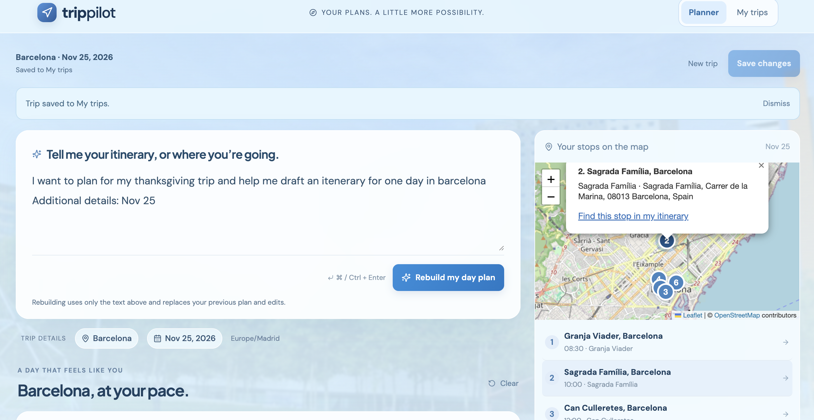
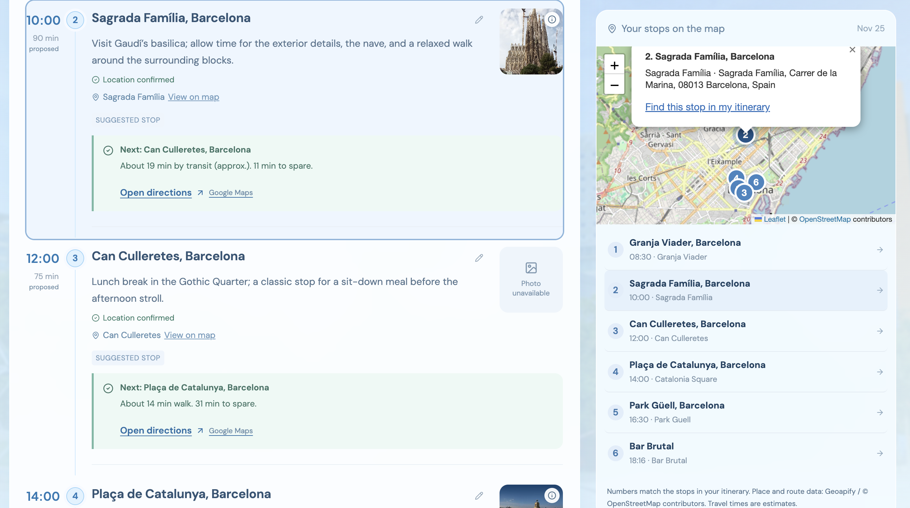
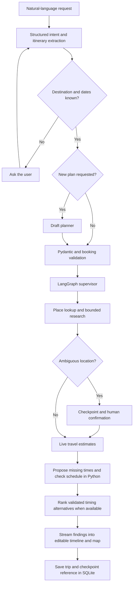

# TripPilot

**An itinerary copilot that turns natural-language travel plans into a grounded, editable schedule—with human confirmation where it matters.**

TripPilot combines LLM workflow orchestration with live place/routing APIs and deterministic schedule validation. It preserves supplied bookings, surfaces ambiguous locations, and streams checks into the itinerary rather than treating generated text as a verified plan.

Built with **Python · FastAPI · Pydantic · LangGraph · OpenAI · React · TypeScript · SQLite · Geoapify · Leaflet**.

**Status:** working local portfolio prototype. Hosting, authentication, and comparative LLM evaluations are future work. No default itinerary or fabricated provider results are used in the application.

[Demo](#demo) · [First-time setup](docs/SETUP.md) · [Architecture and code guide](ARCHITECTURE.md) · [Demo recording guide](docs/DEMO.md) · [Roadmap](BUILD_PLAN.md)

## Demo

[**Watch or download the full walkthrough (83 seconds, MP4)**](docs/media/walkthrough.mp4)

The walkthrough shows date clarification, itinerary generation, location review, travel checks, adding a stop, and saving the trip. It is a screen recording of the app, not a benchmark or a guarantee of future model output. The full sequence is retained at its original speed; the video was resized and compressed for sharing.

**Natural-language planning and synchronized map**

[](docs/media/walkthrough.mp4)

**In-place travel checks, directions links, and numbered stops**



The screenshots and recording were supplied by the project author. Photos and map tiles are retrieved from external providers; their in-app credit controls and map attribution are retained. See [media notes](docs/media/README.md).

## The problem

A plausible itinerary can still send someone to the wrong restaurant branch, move a reservation, or leave too little travel time. TripPilot separates the model's proposals from supplied facts and external evidence, then lets the user resolve uncertainty and accept changes.

## What you can do

- Paste an existing itinerary or ask for a new plan using one natural-language input. Destination, dates, and timezone are extracted; essential missing context triggers a question.
- View editable daily timelines and a map with matching stop numbers. Generate plans for empty dates without rewriting existing stops.
- Use a confirmed, representative starting pin for an explicitly named street walk; the pin is not the whole walking route. Specific landmarks or addresses give more precise meeting points.
- Resolve real locations through Geoapify. Clear named matches are accepted automatically; ambiguous candidates pause for your choice.
- Check visit lengths plus walking, approximate transit, or taxi/car travel estimates. Missing durations and start times receive labeled, editable proposals; supplied times remain anchors.
- See agent/tool progress, location choices, and transfer findings in the affected rows. Apply a checked timing suggestion and recheck without silently changing a booking.
- Search Openverse/Wikimedia for matching place and destination photos. Click a thumbnail for a larger view with source and required credits. Missing photos do not invalidate a confirmed location.
- Open Google Maps directions between confirmed stops using the suggested mode, without a Google API key.
- Save, reopen, rename, duplicate, and delete/undo trips. Reopening restores saved places and available checks without regenerating the itinerary.

## Engineering decisions

| Concern | Implementation | Why it matters |
| --- | --- | --- |
| **Structured outputs** | Pydantic contracts, strict fields, schema-constrained model responses | Validate model output before it becomes application state. |
| **Agent orchestration** | LangGraph supervisor workflow with bounded Place Researcher and Logistics Analyst specialists | Make tool execution, handoffs, and pause/resume behavior explicit. |
| **Tool calling and API integration** | Typed search/nearby/finish actions, provider candidate IDs, validated anchors | Models select permitted actions; Python executes the external tools. |
| **Human-in-the-loop workflows** | LangGraph interrupts and SQLite checkpoints | Ambiguous locations require a choice; a paused run can be restored. |
| **Grounding and validation** | Provider-backed locations/routes; Python duration, date, timezone, and travel arithmetic | An LLM cannot declare a transfer feasible just because it sounds plausible. |
| **Observability** | NDJSON progress events, per-stop states, checkpointed actions, backend model/token usage | Expose what ran, where a workflow paused, and what evidence was available. |
| **Cost-aware design** | Bounded model turns, timeouts, output limits, cached provider responses, reuse of unchanged place matches | Control repeated work while keeping uncertainty explicit. These are not account-wide spending caps. |
| **Persistence** | Separate SQLite trip library and analysis checkpoints; version checks on saves | Keep copies independent and reject stale overwrites. |
| **Verification and handoff** | Offline pytest regression suite, TypeScript checks, production build, GitHub Actions, setup/runbook docs | Make the project runnable and reviewable by another engineer. |

The supervisor is deterministic Python, not another LLM. The reader extracts the request; the optional planner drafts new visits. The Place Researcher observes results and chooses bounded tool actions. The Logistics Analyst ranks timing alternatives already checked by Python. This is a tool-using workflow, not a collection of unconstrained chat agents.

## Workflow



## Quick start

Requirements: **uv**, **Python 3.13** (uv can install it), **Node.js 24**, and **pnpm 11.25.0**. These match the documented setup and CI configuration.

```sh
git clone YOUR_REPOSITORY_URL
cd YOUR_REPOSITORY_DIRECTORY
cp .env.example .env
```

Edit `.env` locally:

```dotenv
OPENAI_API_KEY=your_own_openai_key
OPENAI_MODEL=gpt-5.4-mini
GEOAPIFY_API_KEY=your_own_geoapify_key
```

Keys are required for live itinerary building and place/route checks. Openverse/Wikimedia photo lookup needs no additional key. OpenAI API usage is billed separately from a ChatGPT subscription; check your provider account before making live calls. A compatible model supporting the structured Responses API output can be configured with `OPENAI_MODEL`.

```sh
uv sync --locked --python 3.13
pnpm --dir frontend install --frozen-lockfile
pnpm --dir frontend build
uv run uvicorn trippilot.api:app --host 127.0.0.1 --port 8000
```

Open **http://127.0.0.1:8000/**. The backend serves the built frontend and APIs from one origin. Use **Ctrl+C** to stop it. See [SETUP.md](docs/SETUP.md) for Windows commands, prerequisites, development mode, and troubleshooting.

Example input for a live smoke check (documentation only; not preloaded in the app):

> Barcelona on November 25, 2026. Visit Casa Batlló at 10:00 for 90 minutes, then have lunch at El Nacional at 12:30 for an hour. Use only these two stops.

Choose the intended location if prompted. A build automatically starts place and travel checks. Edit a stop using **Save & check**; use **Save trip** and **My trips** to keep it. **Rebuild my day plan** uses only the current input, clearing previous plan edits and location selections.

## Verification

```sh
uv run pytest -q
pnpm --dir frontend build
```

The current offline suite has **168 passing tests** covering itinerary contracts, booking preservation, ambiguous places, constrained tool use, schedule arithmetic, missing-time proposals, streaming, checkpoint recovery, provider failures, and trip-library persistence/version conflicts. Tests mock external services and do not require API keys. The frontend build includes TypeScript checking. CI runs these checks on pushes and pull requests; the first GitHub run still needs to be observed after publication.

Browser smoke checks exercise generation, location confirmation, edit/recheck, map synchronization, Google Maps links, and save/rename/duplicate/delete/undo. These are manual checks, not an automated browser suite.

**Regression tests are not an LLM quality benchmark.** There is no measured claim here that multiple agents outperform a single agent, or that the system improves travel outcomes. A labeled evaluation set, baseline comparison, latency/cost measurements, and repeated model runs are planned.

## Project structure

```text
trippilot/
  api.py          FastAPI endpoints and streaming/checkpoint restoration
  models.py       Validated itinerary, place, route, and event contracts
  planner.py      Structured extraction and optional itinerary drafting
  workflow.py     LangGraph coordination and human confirmation
  agents.py       Bounded place research and timing-option ranking
  geoapify.py     Grounded place/routing adapter and caching
  checker.py      Deterministic schedule checks
  durations.py    Labeled duration and missing-start proposals
  repairs.py      Generate and validate timing alternatives
  library.py      SQLite saved-trip CRUD and version checks
  photos.py       Optional Openverse/Wikimedia image lookup
frontend/src/     React/TypeScript planner, map, trip library, progress UI
tests/            Offline regression tests and synthetic fixtures
docs/             Setup, demo, and publication guides
.github/workflows/checks.yml
```